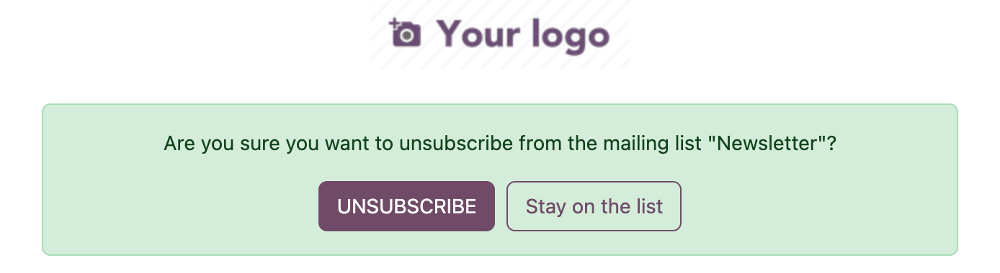
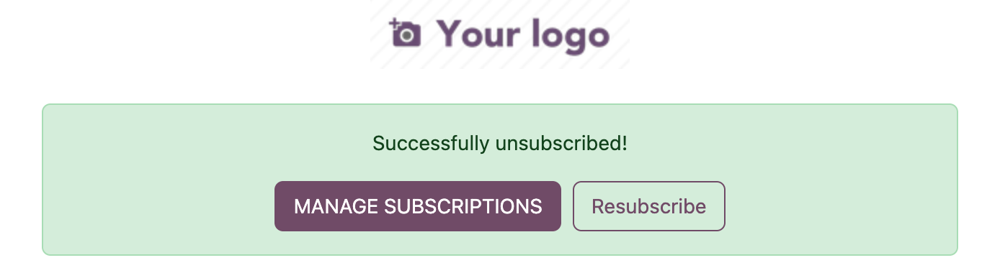
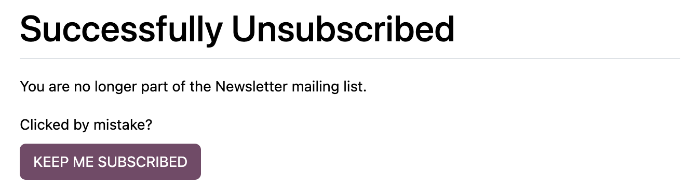

# Mass Mailing Resubscribe

People click unsubscribe by accident. In standard Odoo, getting back on the list means finding a checkbox on a preferences page, ticking it, and saving. Most people won't. This module adds a one-click way back on each page of Odoo's unsubscribe flow.

- **Odoo:** 18.0, 19.0, 20.0 (one branch each)
- **Depends on:** `mass_mailing` only
- **License:** LGPL-3
- **Author:** [19 Prince](https://www.19prince.com)

---

## What it adds

Odoo's unsubscribe link walks the reader through up to three pages. The module adds one button to each.

### 1. "Are you sure?" → Stay on the list



Nothing changes in the database. The message switches to "You're still subscribed."

### 2. "Successfully unsubscribed!" → Resubscribe



One click puts the reader back on the list(s) that email was sent to, and the message reads "You're back on Newsletter."

### 3. Mailing Subscriptions → Keep me subscribed



The same idea on the preferences page. It re-ticks the list and submits Odoo's own form, so the result matches a manual change.

---

## How it decides what to restore

- **Only the lists that email went to.** If someone left another list last month, a resubscribe click won't put them back on it.
- **Only lists marked "Show In Preferences".** Internal lists are never offered or restored.
- **Only by the reader.** The Resubscribe route (`/mailing/<id>/resubscribe`) checks the same signed token as Odoo's unsubscribe link, so nobody can resubscribe someone else's address. A bad token changes nothing.
- **No emails.** The module never sends a "come back" message. Re-opting in is always the reader's own click.

---

## Choosing which lists readers see

Odoo's preferences page lists every public mailing list under "You may also be interested in." Some lists, such as test sends or internal segments, shouldn't be there.

To hide one: **Email Marketing → Mailing Lists →** open the list → untick **Show In Preferences**. No code needed; this is standard Odoo.

---

## Installation

1. Add the module to your addons path, using the branch that matches your Odoo version.
2. **Apps → Update Apps List.**
3. Search **"Mass Mailing: One-Click Resubscribe"** and click **Install**.

No configuration. The buttons appear the next time someone unsubscribes.

Odoo Online doesn't allow custom modules, so this needs Odoo.sh or on-premise.

---

## Gotcha: mailings with no list attached

Odoo's unsubscribe link only opts people out of the lists **attached to the mailing**. A mailing sent to contacts with no list attached (common in Marketing Automation campaigns) shows "Successfully unsubscribed" but changes nothing. That's standard Odoo behavior, not this module. If you run a welcome series or other automation, attach your newsletter list to each of its mailings.

---

## Tests

```
odoo-bin -d <db> -i mass_mailing_resubscribe --test-tags /mass_mailing_resubscribe --stop-after-init
```

The tests cover the button appearing for public lists only, the resubscribe route opting the reader back in, and a bad token being rejected.

## Version notes

The three branches share the same code. The only difference is the route type: `json` on 18.0, `jsonrpc` on 19.0 and 20.0, where `json` is deprecated.

---

Built by [19 Prince](https://www.19prince.com), an Odoo marketing agency.
